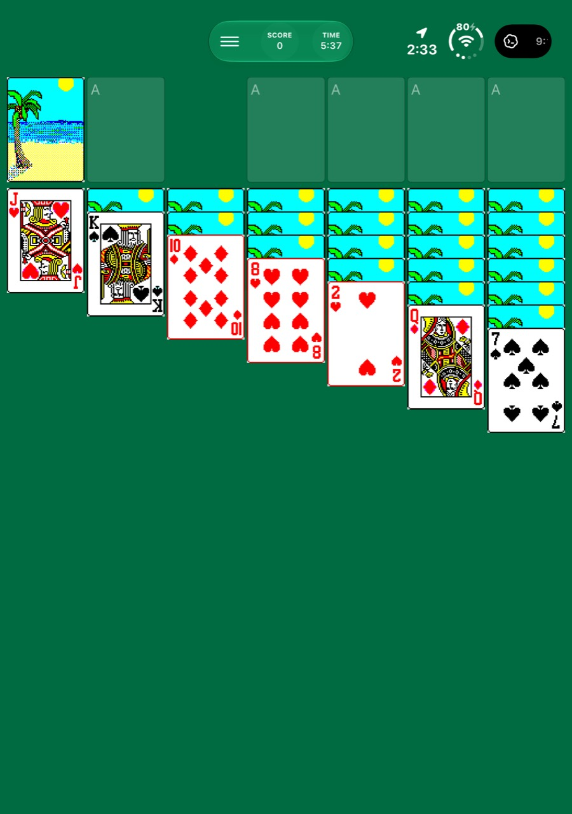
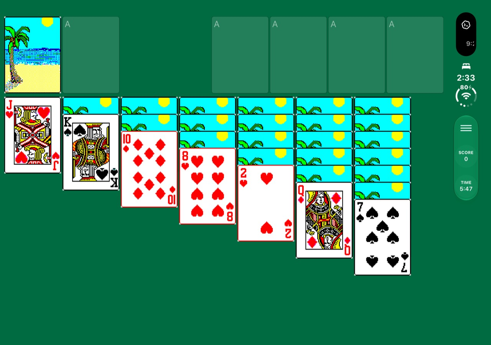
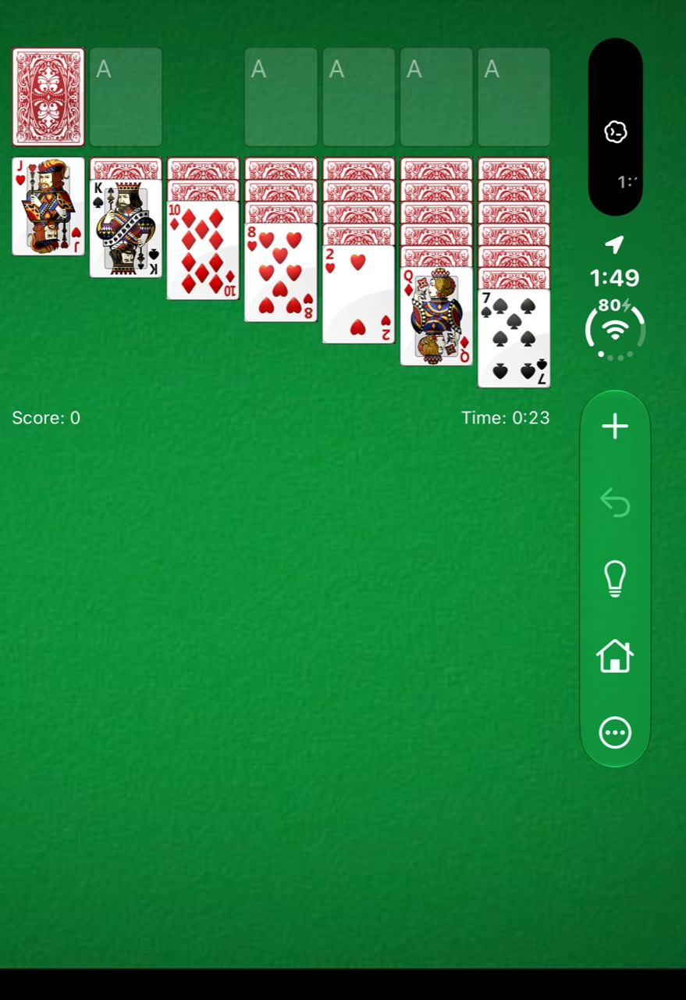
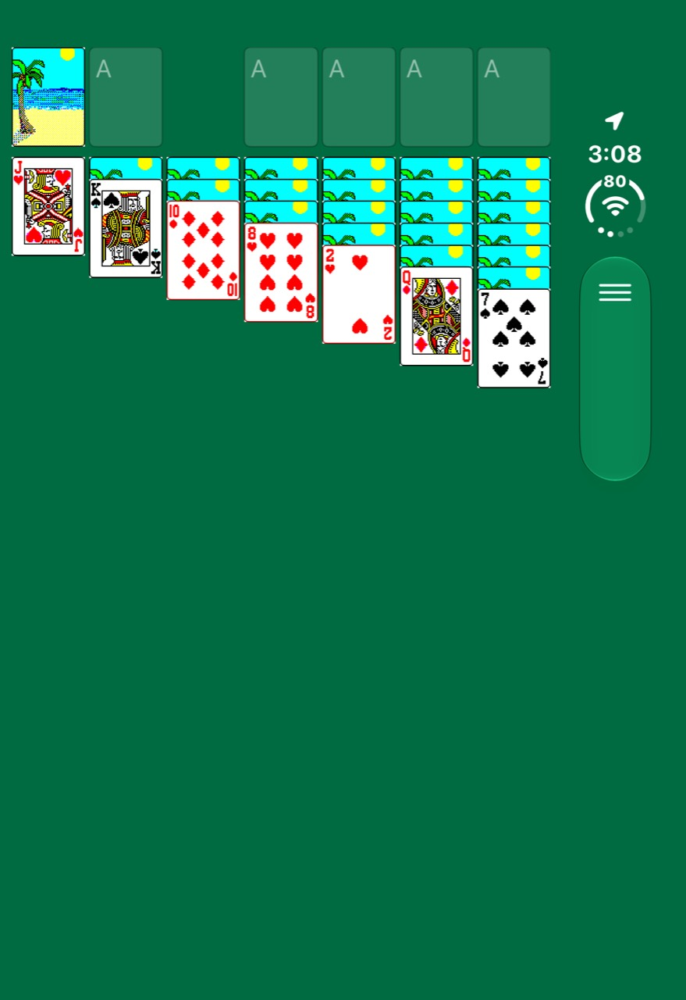

# Classic Solitaire

A native, offline Klondike Solitaire project inspired by the Windows Solitaire games of the Windows 98, XP, and Vista eras. It began as a way to bring the familiar game—and especially the animated palm beach sun and castle card backs—to my mom on modern Apple devices.

Built with Swift, SwiftUI, and SpriteKit, the project shares a Swift game engine across Apple platforms and is being adapted for the iPhone Duo cover and inner displays, the iPhone 13 mini, iPad, and Mac. No accounts, ads, subscriptions, or gameplay tracking are intended.

## In progress

The current development build includes Klondike with draw one or three, local game restoration, undo, hints, theme and card-back selection, and experimental legacy animations and victory effects. Windows 98 and XP artwork also have optional remastered previews. The user interface adapts to folding and rotation, with continuing work on the Duo's native navigation and compact-phone layouts.

This is an evolving recreation, not a finished or verified reproduction of every original Windows behavior. Physical-device testing, scoring parity, animation and audio fidelity, accessibility, and polish remain ongoing. The screenshots below are user-provided photographs of development builds; controls and layout may have changed since they were taken.

## Screenshots

| Duo inner display — portrait | Duo inner display — landscape |
| --- | --- |
|  |  |

| Duo cover — Vista | Duo cover — Windows 98 |
| --- | --- |
|  |  |

## Source and tests

- `Sources/SolitaireEngine/` contains the Swift game rules and state.
- `Tests/SolitaireEngineTests/` contains engine tests; run them with `swift test`.
- `App/ClassicSolitaireApp.swift` contains the SwiftUI application and visual effects.

The engine is a Swift package. The current iOS app is built with the Apple SDK and requires appropriate code signing and separately supplied resources. A complete Xcode project and turnkey app build are not yet included.

## Artwork and rights

This is an independent fan project and is not affiliated with or endorsed by Microsoft or Apple. Windows names and imagery belong to their respective owners. Original Windows executables, extracted game artwork and audio, derived assets, provisioning profiles, and device-signed builds are **not included** in this public repository. The source expects resources that are not provided here, so cloning this repository alone does not reproduce the full appearance shown in the screenshots. Screenshots are provided as project documentation, not as a license to reuse their contents.
